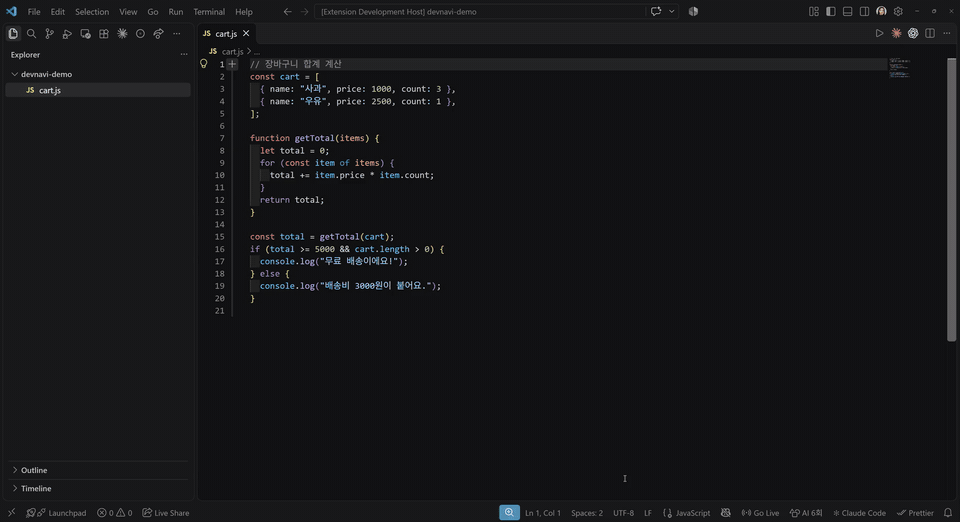
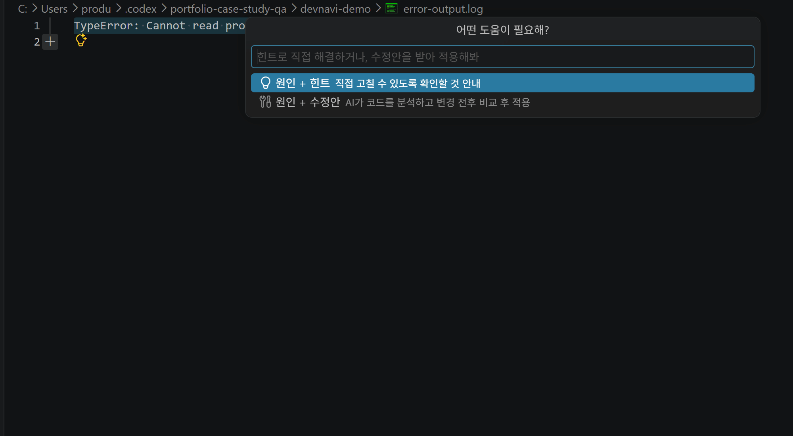

# DevNavi

> **AI가 짜 준 코드, 무슨 뜻인지는 알고 쓰자.**

DevNavi는 Copilot·ChatGPT 같은 AI가 만든 코드를 **쉬운 한국어로 통역**하고,
오류가 나면 **스스로 이해하고 고칠 수 있게** 돕는 VS Code 확장이에요.



---

## 3분 만에 시작하기

**1. 설치** — VS Code 왼쪽 확장(Extensions) 탭에서 `DevNavi` 검색 → 설치

**2. AI 연결** — 아래 중 하나만 하면 돼요.

| 이런 분은 | 이렇게 |
|---|---|
| GitHub Copilot을 쓰고 있다 | 아무것도 안 해도 돼요. 처음 쓸 때 뜨는 허용 창에서 **허용**만 누르세요. |
| Copilot이 없다 | 무료로 시작할 수 있는 **Gemini 키**를 추천해요. [키 받는 법](#ai-연결-방법) |
| AI 없이 써 보고 싶다 | 치트시트·용어 사전·오류 사전은 키 없이도 동작해요. |

**3. 바로 해 보기** — 코드 몇 줄을 드래그하고 **`Ctrl+Alt+Q`**

---

## 주요 기능

### 💬 코드를 한국어로 통역 — `Ctrl+Alt+Q`

- 드래그한 **딱 그만큼**을 코드 바로 아래에 쉬운 한국어로 풀어 줘요.
- 아무것도 선택하지 않고 누르면 **파일 전체**를 통역해요.
- 한 줄 요약 → 코드 순서대로 `코드 조각 → 쉬운 설명` 형식이에요.
- 더 궁금하면 답변 아래 **답글**로 이어서 물어보세요.

```
한 줄 요약 — 장바구니에 담긴 물건의 총 가격을 계산하는 코드야.
let total = 0;   → 'total'이라는 상자를 만들고, 처음에는 0으로 시작해.
for (...) {      → 목록에 있는 물건을 하나씩 꺼내서 반복해.
```

### 🩹 오류 해결 — `Ctrl+Alt+E`



오류 메시지를 드래그하고 누르면 두 가지 중에 고를 수 있어요.

- **원인 + 힌트** — 왜 났는지와 확인할 것만 알려 줘요. 직접 고쳐 보고 싶을 때.
- **원인 + 수정안** — AI가 고칠 코드를 제안해요. **변경 전후를 비교한 뒤** 직접 적용 버튼을 눌러야 반영돼요.

> 수정안은 원본 코드와 정확히 맞는지 검사한 뒤에만 보여 줘요. 저장이나 명령 실행은 절대 자동으로 하지 않아요.

### 그 밖의 기능

| 기능 | 하는 일 | 여는 법 |
|---|---|---|
| 💡 힌트만 받기 | 답 대신 생각할 방향만 알려 줘요 | 코드 드래그 → `Ctrl+Alt+H` |
| 📖 이 단어 뭐야? | 개발 용어를 쉬운 말과 예시로 설명해요 | 단어 드래그 → `Ctrl+Alt+W` |
| 🧭 치트시트 | git·npm·터미널 명령어를 찾아 클릭 한 번에 복사해요 | 왼쪽 **DevNavi** 아이콘 |
| 🗺️ 프로젝트 네비 | "할 일 앱 만들기" 같은 목표를 단계별 체크리스트로 나눠 줘요 | 사이드바 **프로젝트 네비** → `+` |
| 🧐 커밋 전 셀프 리뷰 | 올리기 전에 `console.log`·비밀키·TODO 같은 실수를 찾아 줘요 | `Ctrl+Alt+R` |
| ✍️ 커밋 메시지 추천 | 바뀐 내용을 보고 커밋 메시지 후보를 골라 줘요 | `Ctrl+Alt+M` |
| ✏️ 이름 추천 | 변수·함수 이름 후보를 추천하고 바꿔 줘요 | 이름 드래그 → `Ctrl+Alt+N` |
| 📦 패키지 설명 | `package.json`의 패키지가 뭘 하는지 알려 줘요 | 패키지명 드래그 → 우클릭 |
| 📚 오늘의 학습 회고 | 오늘 자주 물어본 것을 모아 보여 줘요 | `Ctrl+Shift+P` → `DevNavi: 오늘의 학습 회고` |

> 이 코드가 어디서 쓰이는지 보고 싶다면 VS Code 기본 기능 **`Shift+F12`(참조 찾기)**를 쓰세요.

---

## 단축키 한눈에 보기

| 키 | 기능 |
|---|---|
| `Ctrl+Alt+Q` | 한국어로 통역 (선택 없으면 파일 전체) |
| `Ctrl+Alt+H` | 힌트만 받기 |
| `Ctrl+Alt+E` | 오류 해결 (힌트 / 수정안) |
| `Ctrl+Alt+W` | 이 단어 뭐야? |
| `Ctrl+Alt+N` | 이름 추천 |
| `Ctrl+Alt+M` | 커밋 메시지 추천 |
| `Ctrl+Alt+R` | 커밋 전 셀프 리뷰 |

- Mac은 `Ctrl` 대신 `Cmd`예요.
- 단축키를 몰라도 괜찮아요. 코드에서 **우클릭** → DevNavi 메뉴, 또는 `Ctrl+Shift+P` → `DevNavi`로 모든 기능을 쓸 수 있어요.
- 단축키 바꾸기: `Ctrl+Shift+P` → `DevNavi: 단축키 설정`

---

## AI 연결 방법

`Ctrl+Shift+P` → **`DevNavi: LLM 프로바이더 선택`**에서 쓸 AI를 고르고, Copilot이 아니면 **`DevNavi: API 키 설정`**에 키를 붙여 넣으세요.

| AI | 비용 | 키 받는 곳 |
|---|---|---|
| **GitHub Copilot** ⭐ | 추가 비용 없음 (구독 사용) | 키 필요 없음. Copilot Chat 확장에 로그인만 |
| **Google Gemini** | 무료 사용량 있음 | [aistudio.google.com/apikey](https://aistudio.google.com/apikey) |
| **Anthropic Claude** | 유료 (최소 $5 충전) | [console.anthropic.com](https://console.anthropic.com) → API Keys |
| **OpenAI GPT** | 유료 (최소 $5 충전) | [platform.openai.com](https://platform.openai.com) → API keys |

> Claude Pro/Max·ChatGPT Plus 같은 **채팅 구독과 API 키는 별개**예요. API는 따로 충전해야 해요.

---

## 자주 묻는 질문

**내 코드가 어디로 가나요?**
선택한 코드만 내가 고른 AI(Copilot·Gemini 등)로 바로 전송돼요. DevNavi 서버는 없어요.

**API 키는 안전한가요?**
VS Code의 암호화 저장소(SecretStorage)에 보관돼요. 설정 파일에 그대로 남지 않아요. 지울 때는 `DevNavi: API 키 삭제`.

**돈이 얼마나 드나요?**
Copilot은 추가 비용이 없고, Gemini는 무료 사용량이 있어요. 하단 상태바의 🪙 아이콘을 누르면 사용량과 예상 비용을 볼 수 있어요. 용어 사전·오류 사전은 AI 없이 먼저 찾아 보고, 패키지 설명과 프로젝트 힌트는 한 번 받은 답을 저장해 다시 써요.

**AI 없이 쓸 수 있는 기능은?**
치트시트, 용어 사전, 오류 사전(자주 나는 오류 29종), 학습 회고, 토큰 상태바예요.

---

## DevNavi가 하지 않는 것

- ❌ 코드 자동완성 — Copilot이 잘하는 일이에요.
- ❌ 묻지도 않았는데 코드 고치기 — 바꾸는 건 언제나 내가 확인하고 눌러야 해요.
- ✅ **대신 해 주는 게 아니라, 할 수 있게 도와주는 것**

[변경 기록](CHANGELOG.md) · [문제 신고](https://github.com/ProHiera/devnavi/issues) · MIT © 2026 hiera
